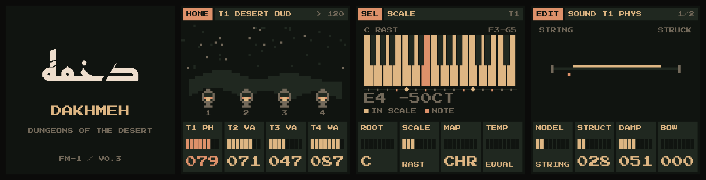

# DAKHMEH — دخمه

Dungeons of the desert.

Custom firmware for the **M-VAVE FM-1**, built on [GR!MM](https://github.com/GRiMMBIENT/grimm).

- Four tracks. Seven engines. Twelve shared voices.
- Maqam scales, adjustable microtones and twelve tashriq switches.
- Independent tuning, tonic and keyboard layout.
- Scala import and historical tuning tables through the browser editor.
- Tuned chords, arpeggiator and 64-step sequencers.
- Oud, qanun, ney, tar, santur, mijwiz, arghul and a synthesized rababa.
- Tape, grain, delay and long reverb.

## Beyond GR!MM

| Feature | GR!MM 1.0 | DAKHMEH |
| --- | --- | --- |
| Scales | 14 Western scales, one for the whole project | 49 scales including Rast, Bayati, Hijaz, Saba, Kurd, Sikah and other maqamat, plus CUSTOM; each track has its own |
| Tuning | 12-TET | Microtonal maqam tables, EQUAL / PYTH / MEAN / JUST temperaments, ±63-cent trims and custom tables in 0.1-cent steps. Held notes retune LIVE, by GLIDE or HOLD |
| Tashriq | none | Twelve C–B switches, −100 to +100 cents each, across every octave |
| Tonic and key layout | one global root | Root and key layout (CHR, SNAP, WHITE, ALL, SEQ) for each track |
| Chords | plain chords on the scale | Chord tones tuned like the maqam, including DIA7 |
| Tuning in the editor | none | Scala import, JSON presets, and historical maqam tunings (DiArMaqAr) |
| Instruments | the GR!MM factory sounds | DESERT category with 12 presets: oud, qanun, two santurs, ney, mijwiz, arghul, rababa, plus 4 sampled banks (oud, qanun, ney air, tar) |
| Polyphony | 6 voices | 12 shared voices |
| Velocity | none | From keys (SENSE curves; FIXED by default), MIDI, steps and the arp. Each step keeps its own velocity, set on the STEP page |
| CANON | none | A second playhead half the pattern behind, a scale interval away or played backwards (ARP's second page) |
| DREAM | none | Press a key to compose an ambient piece across all four tracks. MOOD MAQAM carries the selected track's maqam and tuning (GLO's second page) |
| Arp modes | UP, DOWN, UP-DOWN, RANDOM, AS PLAYED, CHORD | Adds TRILL (each note, then its scale neighbour up) and DRONE (the lowest key keeps sounding) |
| Install | command line | [Browser installer](https://jrdntnnr.github.io/DAKHMEH-FM-1/install.html) as well as `tools/fm1_install.py` |
| Look | GR!MM's warm greys, red accent; HOME: stars, an eye, candles | DESERT colours (obsidian, sandstone, bone, copper) as a fifth COLOUR and a fresh device's; HOME: a night over the dunes, a lantern a track burning with it; a tuning rail under the maqam keyboard (the root a diamond, each degree's cents); MIXER meters; names too long for their place scroll; the keys light the scale on the maqam pages, breathe while DREAM plays, follow CANON, and a light runs them at boot |

Most of the maqam, tuning and desert work, velocity, CANON, DREAM, TRILL and DRONE come from SARDAB (GHOULBOX on Felucca).

## Try it, install it

- **[Emulator](https://jrdntnnr.github.io/DAKHMEH-FM-1/)**: the same firmware in your browser.
- **[Installer](https://jrdntnnr.github.io/DAKHMEH-FM-1/install.html)**: Chrome or Edge, FM-1 connected by USB. Back up first with the [editor](https://jrdntnnr.github.io/DAKHMEH-FM-1/editor.html).
- **[Releases](https://github.com/jrdntnnr/DAKHMEH-FM-1/releases)**: the `.fwsc` package for `tools/fm1_install.py`.

**Pre-release (0.3).** The target build, emulator and installer tests pass. 0.3 runs on an FM-1 (2026-10-19); velocity sensing is untested there. Existing SARDAB projects need conversion.

[Controls & status](docs/PORT.md) · [Build & run](docs/BUILDING.md) · [Screenshots](docs/screens/dakhmeh/README.md) · [Instrument sources](assets/desert/README.md)

GPL-3.0-only. Built from GR!MM, Dinghy, Felucca and SLOOP. [Credits](LICENSING.md).
