# DAKHMEH screens

Captured from the firmware renderer. Native resolution: 240 × 240. Shown at 2×.

| Splash | Home |
| --- | --- |
| 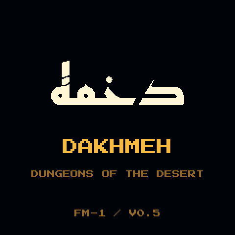 | 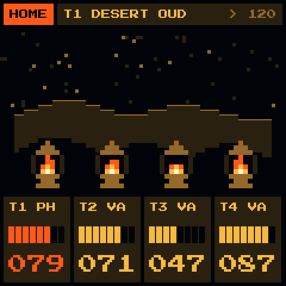 |
| Desert oud | Mixer |
| 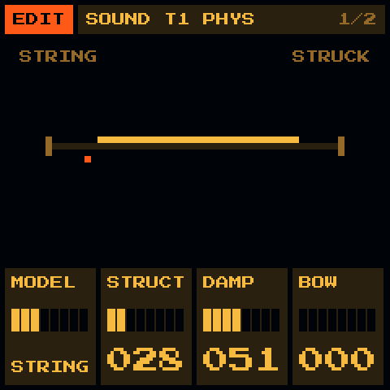 | 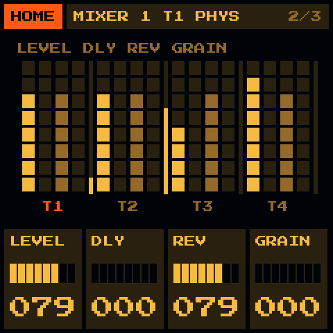 |
| Maqam Rast | Tashriq |
| 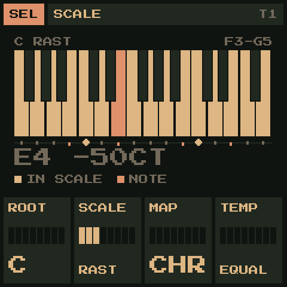 | 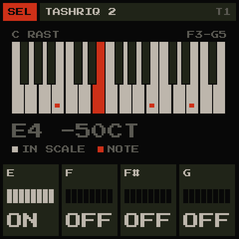 |
| Chords | Tuning |
| 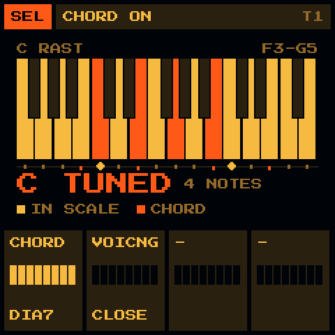 | 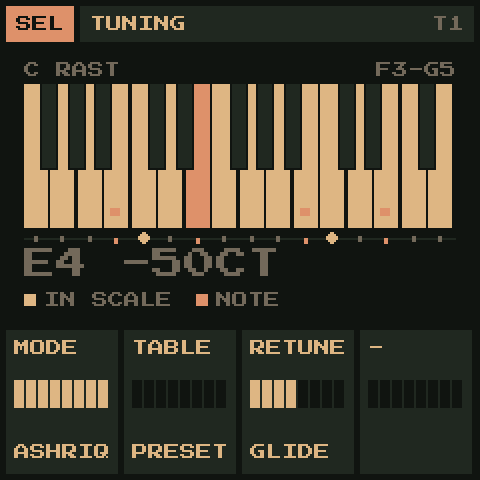 |
| Sequencer | Colour |
| 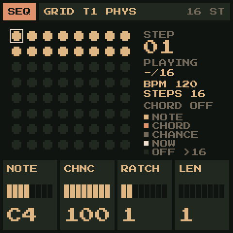 | 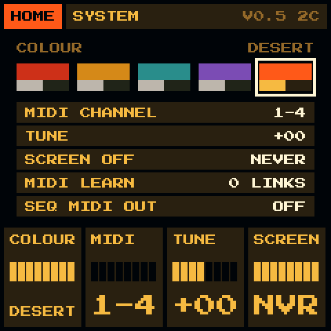 |
| Space | |
| 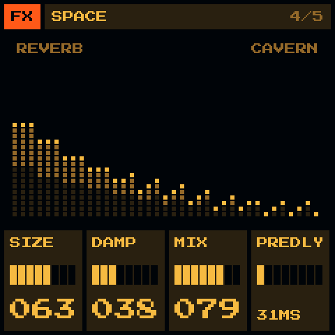 | |

Regenerate: `sh tools/capture_screens.sh`.
Historical GR!MM screenshots remain in the parent directory.
